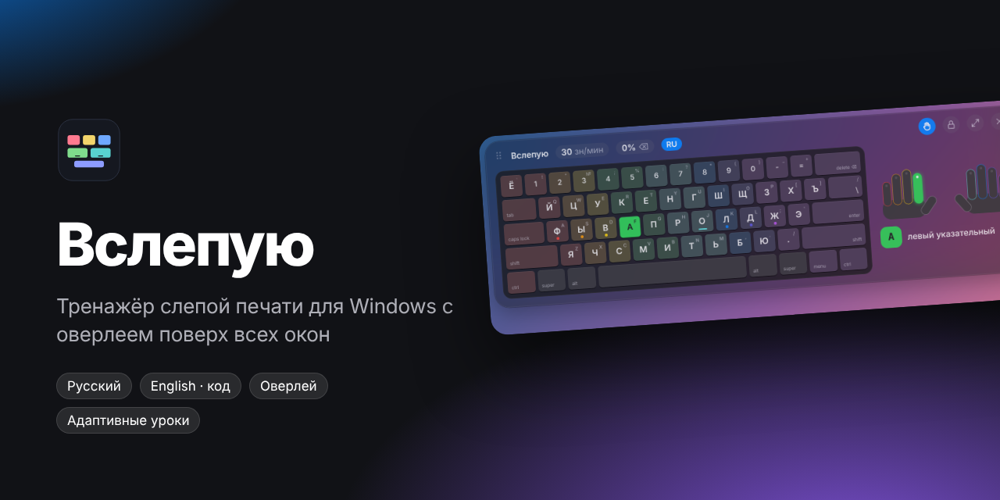
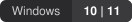
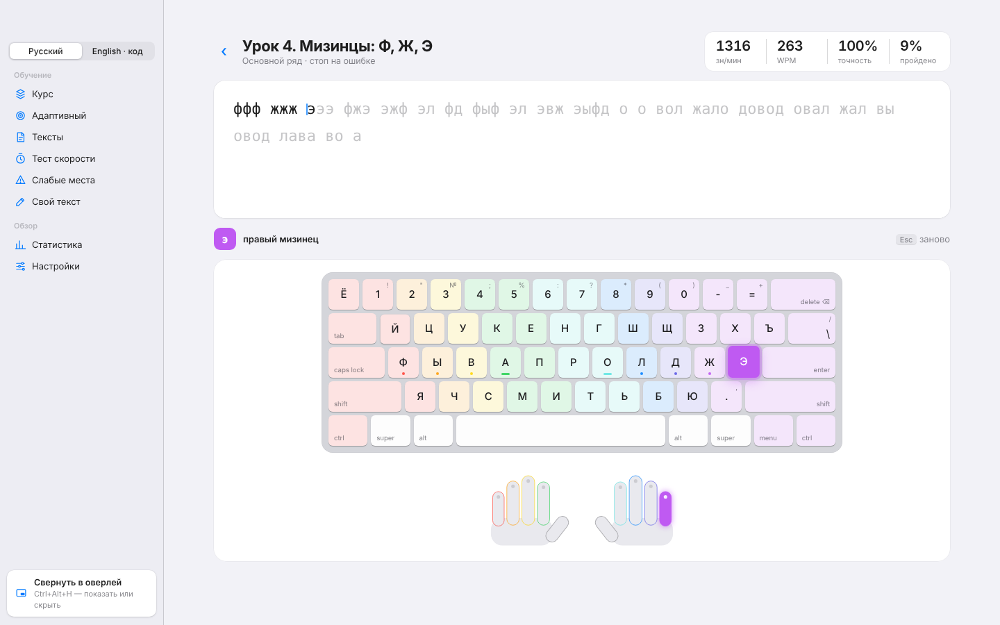
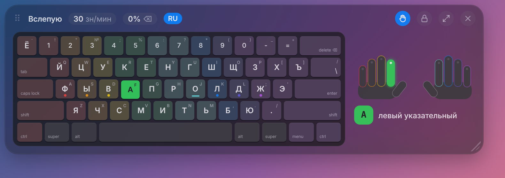
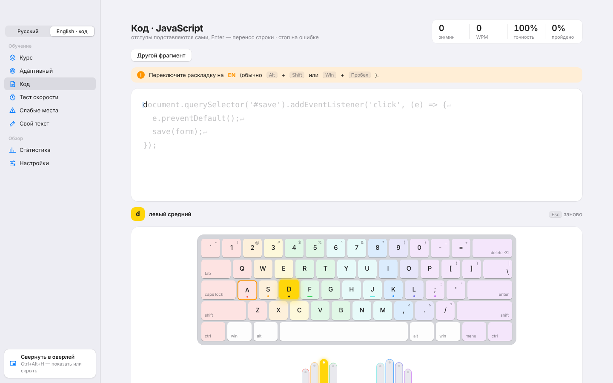
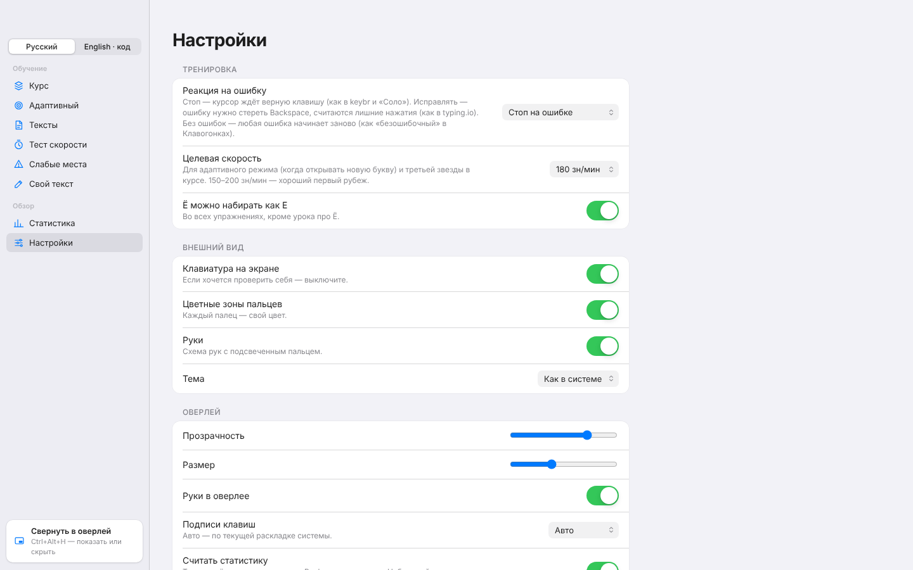

  

<h1 align="center">Вслепую</h1>

  Тренажёр слепой печати для Windows с оверлеем поверх всех окон. 
  Русский — на обычных словах. English — на коде.

  

  
  
  

---

## Установка

1. Откройте **[последний релиз](https://github.com/fotiii/vslepuyu-releases/releases/latest)** и скачайте `Vslepuyu-Setup-x.y.z.exe`.
2. Запустите установщик, выберите папку. Права администратора не нужны.
3. Ярлык **«Вслепую»** появится на рабочем столе и в меню «Пуск».

> [!NOTE]
> Установщик пока не подписан цифровой подписью. Если Windows покажет окно «Windows защитила ваш компьютер», нажмите **Подробнее → Выполнить в любом случае**.

**Требования:** Windows 10 или 11, 64-бит, около 300 МБ на диске.

## Что внутри

- **Курс** — 23 урока для русской раскладки и 31 для английской: от основного ряда до предложений и строк кода.
- **Адаптивный режим** — новые буквы открываются по мере роста скорости, упор на самые слабые.
- **Код** — символы `(){}[]=><"'|&`, `camelCase` и настоящие фрагменты на JS, TS, React, Python, Bash, SQL.
- **Тест скорости, слабые места, свой текст** и подробная статистика.
- **Светлая и тёмная тема** в стиле macOS и iOS.

## Оверлей поверх всех окон

Сверните приложение в оверлей и печатайте где угодно — он покажет, каким пальцем нажимать каждую клавишу, проверит Shift и посчитает скорость. Буквы текущей раскладки становятся крупными сами.

| Клавиши | Действие |
|---|---|
| <kbd>Ctrl</kbd>+<kbd>Alt</kbd>+<kbd>H</kbd> | показать или скрыть |
| <kbd>Ctrl</kbd>+<kbd>Alt</kbd>+<kbd>K</kbd> | закрепить — клики проходят насквозь |
| <kbd>Ctrl</kbd>+<kbd>Alt</kbd>+<kbd>J</kbd> | открыть приложение |

Размер — уголок справа внизу или <kbd>Ctrl</kbd> + колёсико.

> [!IMPORTANT]
> Оверлей получает только коды клавиш. Набранный текст не сохраняется и никуда не отправляется — приложение работает полностью офлайн.

  
  

## Вопросы

<b>Антивирус ругается на программу</b>

Оверлею нужно видеть нажатия в других окнах, поэтому он ставит стандартный системный хук клавиатуры — так работают все подобные программы. Текст при этом не записывается.

<b>Оверлей не виден поверх игры</b>

Полноэкранные игры перекрывают всё. Переключите игру в режим «окно без рамки».

<b>Метка RU/EN не меняется</b>

Выберите подписи вручную: **Настройки → Оверлей → Подписи клавиш**.

<b>Как обновиться</b>

Скачайте новую версию и установите поверх — прогресс сохранится.

## Нашли ошибку?

Опишите её в **[Issues](https://github.com/fotiii/vslepuyu-releases/issues/new)** — скриншот очень помогает.

---

История изменений — в <a href="CHANGELOG.md">CHANGELOG.md</a> · © 2026 fotiii · <a href="LICENSE">MIT</a>

